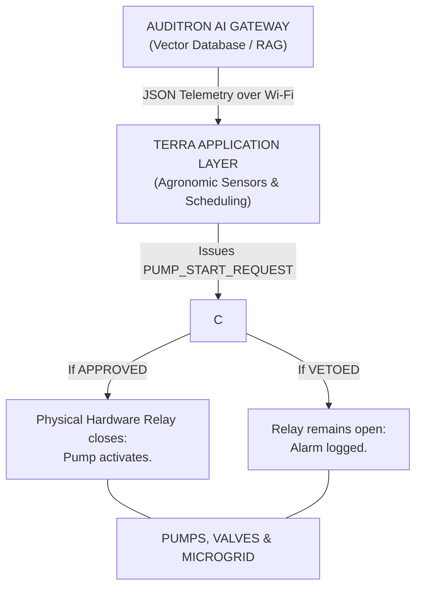

# Project Nika - Terra: Smart Agriculture & Predictive Telemetry Framework

## Technical System Documentation for JKUAT Inter-University Hackathon 2026

## 1. Executive Summary & Problem Statement
Modern precision agriculture relies heavily on automated irrigation and microgrid-powered machinery. However, existing smart-farming systems operate with a dangerous disconnect: **environmental controllers activate pumps based solely on soil moisture without assessing the electrical and mechanical health of the power infrastructure.**

This leads to catastrophic field failures:
- Submersible pumps burn out from dry-running (undercurrent sags).
- Solar microgrid inverters trip from brownout sags.
- Crops suffer from unmonitored system halts.

**Project Terra** solves this by establishing a three-tier, "zero-trust" hybrid edge architecture. Irrigation logic is **decoupled** from hardware control. Agronomic logic requests actions (e.g., "Activate Sector 1 Pump"), but the dedicated Nika Safety Interlock holds ultimate **veto power** over the physical hardware relay, analyzing real-time power quality before allowing actuation.

## 2. System Architecture & Veto Protocol
Terra operates across three primary conceptual layers:

### The Terra/Nika Interlock Bridge

### Layer Responsibilities
Subsystem | Primary Function | Monitored Metrics / Inputs | Actuation / Output
----------|------------------|----------------------------|-------------------
Nika Core | Electrical and Mechanical Asset Protection | Vrms, Irms, Power Factor, THD | Hardware Relay Trip / Lockout
Terra Engine | Agronomic Automation & Resource Optimization | Soil Moisture (VWC), Ambient Temp/RH Reservoir Levels | Solenoid Sector Valves, Pump Request Signals
Auditron AI | Semantic RAG Audit & Diagnostic Intelligence | Ingested Operational JSON Payloads & Fault Logs | Vector Search, Natural Language Diagnostics

*(Note): Enterprise high-density time-series synchronization is reserved for future integration via Synctron.*

## 3. Hardware & Sensor Interface Specification
The Terra edge stack executes on the ESP32-S3 microcontroller, leveraging its dual-core architecture to isolate high-speed DSP analytics from background networking and radio tasks.

### Pin-to-Signal Map
Signal Name | ESP32-S3 Pin | Driver / Protocol | Purpose
------------|--------------|-------------------|--------
`GPIO_RELAY_TRIP` | GPIO 4 | Digital Output | Low-level trigger for main power relay
`GPIO_MANUAL_RESET` | GPIO 5 | Digital Input (Pull-up) | Technician HITL manual reset button
`GPIO_STATUS_LED` | GPIO 2 | Digital Output | Operational state status LED
`ALERT_LED_GPIO` | GPIO 15 | Digital Output | Hardware anomaly alert indicator
`ADC_SOIL_MOIST` | GPIO 11 (ADC1_CH10) | Analog ADC (12 bit) | Volumetric Water Content (VWC) measurement
`ONEWIRE_AMB_TEMP` | GPIO 6 | OneWire / DHT Driver | Ambient Air Temperature and Humidity
`GPIO_WATER_LEVEL` | GPIO 7 | Digital Input (Interrupt) | Low-level float switch for pump protection
`GPIO_VALVE_SEC1` | GPIO 10 | Digital Output (GPIO) | Transistor drive for 5V Mini Water Pump / Solenoid Valve
`I2C_SDA / SCL` | GPIO 8 / 9 | I2C (400 kHz) | SSD1306 Local Display connection

### Interlock Safety Veto Matrix
Agronomic Request | Electrical / Mechanical State (Real-time Nika Audit) | Nika Interlock Decision | Action Taken
------------------|------------------------------------------------------|-------------------------|-------------
Pump START | Vrms = 220V, Irms = 0.0 A (Healthy) | **APPROVED** | Relay closes; Pump starts.
Pump RUNNING | Irms < 0.8A for > 2 secs | **VETO / TRIP** | Undercurrent Detected (Dry Run). Relay opened.
Pump START | Vrms < 195V (Brownout Sag) | **VETO / DENIED** | Relay remains open; Alarm logged.
Pump RUNNING | Irms > 15.0A | **VETO / TRIP** | Overcurrent Detected (Jam). Relay opened.

## 4. Firmware Architecture (ESP-IDF/ FreeRTOS)
Terra utilizes the dual cores of the ESP32-S3 to separate networking tasks from deterministic analytics:
- CORE 0 (PRO CPU): Wi-Fi Comms, Telemetry Publishing, n8n Automation.
- CORE 1 (APP CPU): Grid Acquisition ISR (16kHz), `analytics_task`, `agronomic_sensor_task`, and the Nika State Machine.

### Key FreeRTOS Tasks
1. `grid_acquisition_task` (Core 1, ISR triggered @ 16kHz): Advances phase accumulators and writes dual voltage/current indices into DMA ping-pong buffers without CPU blocking.
2. `analytics_task` (Core1, Priority 15): Aggregates over 1000ms, computing real Vrms, PF, and THD. Calls the safety interlock evaluation pipeline.
3. `agronomic_sensor_task` (Core 1, Priority 5): Samples analog moisture values, DHT22 ambient sensors, and applies moving-average filters.
4. `irrigation_controller_task` (Core 1, Priority 8): Evaluates soil moisture against thresholds. Issues PUMP_START_REQUEST and drives teh physical water pump actuator.
5. `telemetry_publisher_task` (Core 0, Priority 3): Assembles unified JSON payloads and publishes them to the Auditron Gateway over Wi-Fi.

## 5. Auditron AI Gateway Integration (Vector DB / RAG)
Auditron ingests structured JSON telemetry frames from Terra every 5 seconds, containing both agronomic and detailed power diagnostic data. It vector-indexes these system state events into high-dimensional embeddings.

This enables semantic retrieval and natural-langauge auditing over historical operational logs:

**Example Operator Query:** "Why did Sector 1 shut down around 2:15 PM?"

**Retrieved Log Vector (telemetry schema):**
`{"event": "PUMP_START_REQUEST", "status": "VETOED", "reason": "FAULT_UNDERCURRENT", "i_rms": 0.3}`

**Auditron AI Response:**
    "The irrigation system attempted to activate Sector 1 at 2:15 PM due to low soil moisture (14.2%). However, the Nika Interlock vetoed the request and opened the relay because motor current dropped to 0.3A, triggering an Undercurrent (dry-run) protection trip."

## 6. Hardware-in-the-loop (HITL) Test Flow
### Test 1: Nominal Operation
1. Power on the ESP32-S3 Test Bench with `fault_mode = false`.
2. Dip the capacitive soil moisture sensor into dry soil (<20% VWC).
3. **Result:** OLED displays `State: OPERATIONAL`. Vrms ≈ 225V, Irms ≈ 4.1A. Sector 1 Water Pump activates, and the physical Relay clicks CLOSED (Green Status LED ON).

### Test 2: Autonomous Undercurrent Dry-Run Protection
1. Send the `FAULT` command over USB Serial or trigger the fault toggle button (HIL simulation).
2. The SINE_LUT engine adjusts scales to simulate a brownout sag and severe current drop below 0.8A (simulating a snapped drive or dry-running pump).
3. **Result:** Within 2 seconds (persistence filter), the Nika interlock trips. The physical Relay clicks OPEN (Red Alert LED ON), the water pump shuts down immediately, and the OLED displays `FAULT_UNDERCURRENT`.

### Test 3: Human-in-the-loop (HITL) Manual Reset Verification
1. Send the `NORMAL` command over USB Serial (fault condition clear).
2. **Result:** The system remains safely locked in `STATE_TRIPPED_LOCKED` (Red Alert LED remains ON), refusing irrigation requests despite healthy grid quality.
3. Technician physically presses the Manual Reset Button (GPIO 5).
4. **Result:** Relay re-closes, Green Status LED ON, and normal operational state resumes.

### Contributors & Presentation Team
Presented at Jomo Kenyatta University of Agriculture & Technology (JKUAT) Inter-University Hackathon - 2026.
- **Team Lead**: Chrix Eledu | chrixeledu@students.teau.ac.ke | Computer Science and IT (400 Level)
- **Team Member 2**: Kaburia Dean Wamocho || Computer Science and IT (200 Level)
- **Team Member 3**: Joseph Mamlin | Computer Science and IT (400 Level)
- **Team Member 4**: Fiona Ndanu | Computer Science and IT (400 Level)
- **Team Member 5**: Rebecca Ngakani | Computer Science and IT (400 Level)